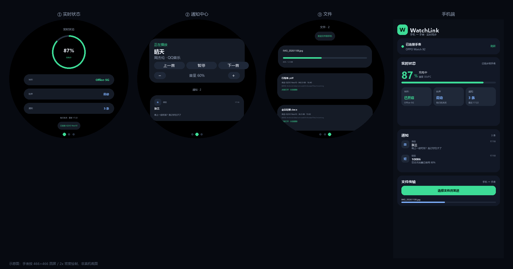

# WatchLink · 手机 ↔ 手表 实时互联

两个原生 App，一套局域网协议：

| App | 包名 | 作用 |
| --- | --- | --- |
| 手机端 | `com.watchlink.phone` | 采集状态/通知/媒体，推给手表；执行手表指令；双向传文件 |
| 手表端 | `com.watchlink.wear` | 三页：实时状态 / 通知 + 媒体 / 文件 |

适配设备：**iQOO Neo10（Android 16）** + **OPPO Watch X2（ColorOS Watch，Android 11，466×466）**。
ColorOS Watch 没有 Google 服务，所以不用 Wear OS Data Layer，而是**同一 WiFi 下的局域网直连**
（手机 TCP 服务端 + UDP 发现），两端都是原生 APK。



> 示意图由 `tools/make_preview.py` 按 466×466 圆屏参数生成，非真机截图。

---

## v1.2 新增

| 需求 | 实现 |
| --- | --- |
| 手表 → 手机 传文件 | 手表文件页顶部「发送文件到手机」→ 系统选文件 → 进度卡片；手机端存到 **下载/WatchLink**，界面上列出「手表发来的文件」 |
| 手机端扫描 3 分钟后停止 | 启动/回到前台开一个 3 分钟「可被发现」窗口，到期自动停 UDP 发现 |
| 扫描不再常驻通知 | 3 分钟窗口到期且没有手表连着，就撤掉前台通知（服务保留 TCP 监听）；手表一连上立刻恢复 |
| 第二页媒体控制 | 手机正在播放时，第二页顶部出现「正在播放 + 歌名 + 歌手/App + 上一首/暂停/下一首 + 音量 −/+」；暂停后按钮变「播放」 |
| 清除手机通知 | 每条通知右下角「清除」，列表顶部「清除全部」，直接调 `cancelNotification` 清掉手机上的通知 |
| 无通知时显示「无通知」 | 第二页空列表时只显示大字「无通知」 |
| 手机端保活 | 新增「允许后台运行」按钮（忽略电池优化）；手机回到前台会重新开 3 分钟发现窗口 |

---

## 一、功能一览

### 手机端
- 🔋 电量 / 充电 / 电池温度　📶 WiFi 开关、连接状态、SSID　🔔 静音·震动·响铃、免打扰
- 📨 通知（App 名、标题、正文、时间），可被手表清除
- 🎵 媒体状态（歌名、歌手、播放中、音量），可被手表暂停/切歌/调音量
- 📤📥 双向传文件　🔌 连接状态、手机 IP/端口　🔋 电池优化白名单入口

### 手表端（左右滑动三页）
1. **实时状态**：电量圆环、WiFi、铃声、通知条数、免打扰、更新时间、连接状态
2. **通知 + 媒体**：媒体卡片（正在播放/控制）、通知列表（可单条清除/全部清除）、空态「无通知」
3. **文件**：发送到手机、接收进度、已收文件（点按打开/安装，长按删除、显示来源与保存路径）

---

## 二、目录结构

```
WatchLink/
├── shared/                  # 纯 Kotlin 协议库（无 Android 依赖，6 个单测）
│   ├── Models.kt            # StatusSnapshot / WatchNotification / MediaState / ReceivedFile / TransferProgress
│   ├── Protocol.kt          # 端口、帧类型、指令常量
│   ├── Frames.kt            # 帧编解码 + CommandCodec + FrameReader/Writer
│   └── Codecs.kt
├── phone/                   # Compose Material3
│   ├── LinkService.kt       # 前台服务 + MediaMonitor + 指令执行
│   ├── LanServer.kt         # TCP/UDP + 双向文件
│   ├── PhoneFileSaver.kt    # 存到 下载/WatchLink
│   ├── StatusCollector.kt / PhoneNotificationListener.kt / AppState.kt / NetworkUtils.kt
│   └── ui/PhoneScreen.kt
├── wear/                    # 原生 View，无 Compose
│   ├── MainActivity.kt / WatchClient.kt / WearLinkService.kt / WatchStorage.kt / WearState.kt
│   └── ui/ StatusPage, NotificationsPage, FilesPage, SwipePager, BatteryRingView, Ui
└── dist/                    # 两个 APK + 示意图
```

---

## 三、协议

```
一帧 = [4 字节长度][1 字节类型][payload]
类型：HELLO / STATUS / NOTIFICATIONS / MEDIA / COMMAND / FILE_BEGIN / FILE_DATA / FILE_END / PING / PONG
文件：FILE_BEGIN(transferId, 名称, 大小, MIME) → FILE_DATA(transferId + 32KB) → FILE_END(transferId)
指令：CommandCodec ——  "dismiss|<通知 key>" / "clear_notifications" / "media_toggle" /
      "media_next" / "media_prev" / "volume_up" / "volume_down" / "refresh"
```

带 `transferId` 是为了支持双向同时传文件（谁发谁收都按 id 归类）。

---

## 四、编译

```bash
./gradlew assembleRelease     # 约 1.7 MB（手机）/ 240 KB（手表）
./gradlew assembleDebug
```

- 手机端：`phone/build/outputs/apk/release/phone-release.apk`
- 手表端：`wear/build/outputs/apk/release/wear-release.apk`
- release 开了 R8 + 资源裁剪，签名用 debug key，可直接安装

---

## 五、安装与配对

**手机端**：安装 `WatchLink-phone-v1.2.apk` → 授权通知权限、**通知使用权**（媒体控制和清除通知都依赖它）→ 顶部显示 `手机 IP · 端口 8975`。

**手表端**：
```bash
adb connect 192.168.x.y:5555
adb install -r WatchLink-wear-v1.2.apk
```

**连接逻辑**
1. 手机 App 打开 / 回到前台 → 开启 3 分钟发现窗口，手表打开 App 就能被自动连上
2. 3 分钟后手机停止广播、撤掉常驻通知；已连接的会话不受影响
3. 手表再次打开 App：先用 UDP 找，找不到就用上次记住的手机 IP 直连（手机进程还在就能连上）
4. 连不上 = 手机端后台被系统回收了，打开一次手机 App 即可

---

## 六、已知限制

| 限制 | 说明 |
| --- | --- |
| 必须同一 WiFi | 走局域网；手机开热点让手表连也可以 |
| 手机端可能被回收 | 3 分钟后撤掉前台通知，厂商省电策略可能杀进程；界面上有「允许后台运行」按钮可加白名单 |
| 手表文件选择器 | ColorOS Watch 若无「文件」应用，点「发送文件到手机」会提示没有选择器 |
| 媒体控制 | 依赖通知使用权；部分播放器不暴露 MediaSession，会显示「无媒体」 |
| 清除通知 | 只能清除通知栏里存在的通知，不能删除 App 内的消息 |
| 局域网无加密 | 协议无鉴权，建议在可信 WiFi 使用 |
| 未真机验证 | 编译通过、协议单测通过，但当前环境无设备，实际手感需实测 |

---

## 七、下一步

- 手表遥控：锁屏 / 截屏 / 全局返回（需无障碍一次授权）
- 配对码 + 传输加密
- 通知按 App 过滤
